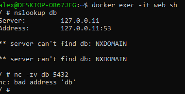
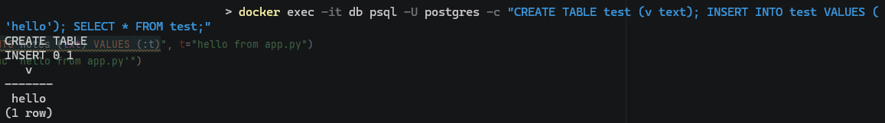
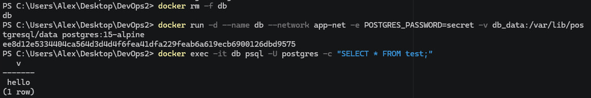
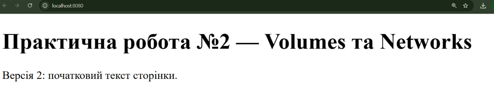

# Практична робота №2 — Volumes та Networks

**Варіант 2:** `postgres:15-alpine` (Named Volume) + `nginx:alpine` (Bind Mount); мережева видимість — `nc -zv db 5432`.

Стек із двох контейнерів у власній Docker-мережі. Доводимо: (1) застосунок бачить базу за іменем `db`, (2) дані бази переживають видалення контейнера, (3) зміни коду видно одразу без перезбірки образу.

## Структура репозиторію
| Файл | Призначення |
|---|---|
| `site/index.html` | Сторінка для nginx (Bind Mount) |
| `app.py` | Python-застосунок, що підключається до БД за іменем `db` (бонус) |
| `screenshots/` | Скріншоти для звіту |
| `Practice_02_Report_Variant2.docx` | Повний звіт |

## 1. Створення мережі
```
docker network create app-net
```

## 2. Запуск контейнерів
```
docker run -d --name db --network app-net -e POSTGRES_PASSWORD=secret -v db_data:/var/lib/postgresql/data postgres:15-alpine
docker run -d --name web --network app-net -p 8080:80 -v "${PWD}/site:/usr/share/nginx/html" nginx:alpine
```

## 3. Скріншот №1 — резолвінг імені `db`
```
docker exec -it web sh
nslookup db
nc -zv db 5432
```


## 4. Скріншот №2 — персистентність
```
docker exec -it db psql -U postgres -c "CREATE TABLE test (v text); INSERT INTO test VALUES ('hello'); SELECT * FROM test;"
docker rm -f db
# повторний docker run з кроку 2
docker exec -it db psql -U postgres -c "SELECT * FROM test;"
```


## 5. Скріншот №3 — live-редагування
Змінено текст у `site/index.html` на хості; після F5 у браузері зміна видна одразу, без `docker build` і `docker restart`.



## 6. `app.py`
```
docker run --rm --name pyapp --network app-net -v "${PWD}:/app" -w /app python:3.12-alpine sh -c "pip install -q pg8000 && python app.py"
```

