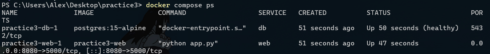
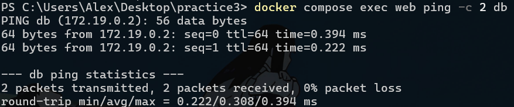
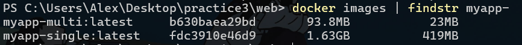

# Практична робота №3 — Docker Compose та Multi-stage builds

**Варіант:** Частина 1 — Варіант А (власний застосунок + `postgres:15-alpine` з named volume); Частина 2 — Варіант 2 (Python).

## Структура репозиторію
| Файл | Призначення |
|---|---|
| `docker-compose.yml` | Стек `db` + `web` одним файлом |
| `web/app.py` | Flask-застосунок, що підключається до БД за іменем сервісу `db` |
| `web/requirements.txt` | Залежності (flask, pg8000) |
| `web/Dockerfile.single` | Однопрохідний образ (`python:3.12`) |
| `web/Dockerfile.multi` | Multi-stage: builder `python:3.12-slim` → фінальний `python:3.12-alpine` |
| `screenshots/` | Скріншоти для звіту |

## Частина 1. Docker Compose

`docker-compose.yml`:
```yaml
services:
  db:
    image: postgres:15-alpine
    environment:
      POSTGRES_PASSWORD: secret
    volumes:
      - db_data:/var/lib/postgresql/data
    healthcheck:
      test: ["CMD-SHELL", "pg_isready -U postgres"]
      interval: 3s
      timeout: 3s
      retries: 10

  web:
    build:
      context: ./web
      dockerfile: Dockerfile.multi
    environment:
      DB_HOST: db
      POSTGRES_PASSWORD: secret
    ports:
      - "8080:5000"
    depends_on:
      db:
        condition: service_healthy

volumes:
  db_data:
```

```
docker compose up -d --build
docker compose ps
docker compose exec web ping -c 2 db
docker compose down
```

### Скріншот №1 — `docker compose ps`
Обидва сервіси у стані Up (`db` — healthy).



### Скріншот №2 — `web` бачить `db` за іменем


## Частина 2. Multi-stage build

`web/Dockerfile.single`:
```dockerfile
FROM python:3.12
WORKDIR /app
COPY requirements.txt .
RUN pip install -r requirements.txt
COPY app.py .
EXPOSE 5000
CMD ["python", "app.py"]
```

`web/Dockerfile.multi`:
```dockerfile
FROM python:3.12-slim AS builder
WORKDIR /app
COPY requirements.txt .
RUN pip install --no-cache-dir --prefix=/install -r requirements.txt

FROM python:3.12-alpine
WORKDIR /app
COPY --from=builder /install /usr/local
COPY app.py .
EXPOSE 5000
CMD ["python", "app.py"]
```

```
cd web
docker build -f Dockerfile.single -t myapp-single .
docker build -f Dockerfile.multi  -t myapp-multi  .
docker images | findstr myapp-
```

### Скріншот №3 — порівняння розмірів


| Образ | Розмір |
|---|---|
| `myapp-single` | 1.63 GB |
| `myapp-multi` | 93.8 MB |

## Висновок
Розмір образу зменшився приблизно в 17 разів: з 1.63 ГБ (`myapp-single`) до 93.8 МБ (`myapp-multi`). У фінальну стадію не потрапили повний базовий образ `python:3.12` (компілятори, системні бібліотеки та інструменти збірки), стадія builder на `python:3.12-slim` та кеш pip. Через `COPY --from=builder` скопійовано лише встановлені пакети Python (`/install`) та файл `app.py`, а базою став мінімальний `python:3.12-alpine`.
